# ARCHITECTURE.md — Decentralized Record Verifier with NLP Search

| | |
|---|---|
| **Project** | Decentralized Record Verifier with NLP Search (Web3 & AI) |
| **Owner / Mentor** | Vipul Ahirrao / Dr. Dipak Bhadane |
| **Version** | 1.0 (proposal-stage design), 1 Nov 2026 |
| **Companions** | `prd.md` (requirements), `design.md` (frontend design) |
| **Status of decisions** | Items marked **Proposed** are design choices to confirm in the design phase (Week 3). Nothing here is implemented or measured. |

---

## 1. Purpose and scope

This document describes the technical architecture of the prototype: components, boundaries, data, interfaces, security controls and deployment. It is written so that a developer can build from it and an examiner can see *why* the system is shaped this way.

**In scope:** file-integrity verification, blockchain registry, natural-language query interpretation, authorization, evaluation harness, local deployment.
**Out of scope:** production hosting, issuer identity federation, W3C VC/DID compliance, real student data.

---

## 2. Architectural drivers

| Driver | Source | Architectural consequence |
|---|---|---|
| Detect any file change | PRD G1, FR-02/03 | Hash raw bytes with SHA-256; compare on a deterministic path with no model involved |
| Model must never hold authority | PRD G4, FR-22, SR-02 | Separate *interpretation* (SLM) from *authorization* (validator + contract) |
| Privileged actions need independent enforcement | PRD FR-13, SR-01 | Access control in **both** backend and smart contract |
| Minimal on-chain data, no personal data | PRD SR-04 | Store only hash, issuer, timestamps, status |
| Fair SLM vs baseline comparison | PRD G5, FR-27 | Both parsers implement one interface and feed the same validator |
| Runs on a student laptop | PRD NFR | Local EVM chain, locally hosted small model, no paid cloud dependencies |
| Reproducible evaluation | PRD §14 | Pinned versions, deterministic decoding, versioned dataset, scripted runs |

## 3. Design principles

1. **The model interprets; the backend decides; the contract enforces.**
2. **Fail closed.** Any validation failure, timeout or ambiguity results in a refusal or a clarification, never a guess.
3. **Allowlist, not blocklist.** Only predefined intents and contract functions exist.
4. **Minimal trusted surface.** Keep the validator and contract small and fully tested.
5. **Stateless requests.** No conversation memory in the NLP path.
6. **Honest labelling.** The system reports file integrity, not issuer legitimacy.
7. **Simplicity.** Prefer one process and a few modules over distributed services.

---

## 4. System context (C4 level 1)

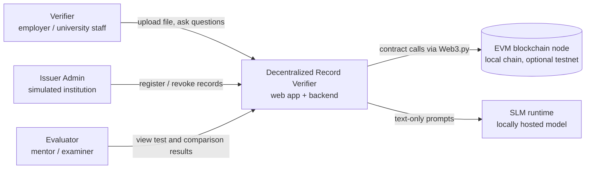

External dependencies are limited to the blockchain node and the model runtime. Both run locally in the MVP. A public testnet RPC provider would add a centralized dependency (stretch goal).

---

## 5. Container view (C4 level 2)

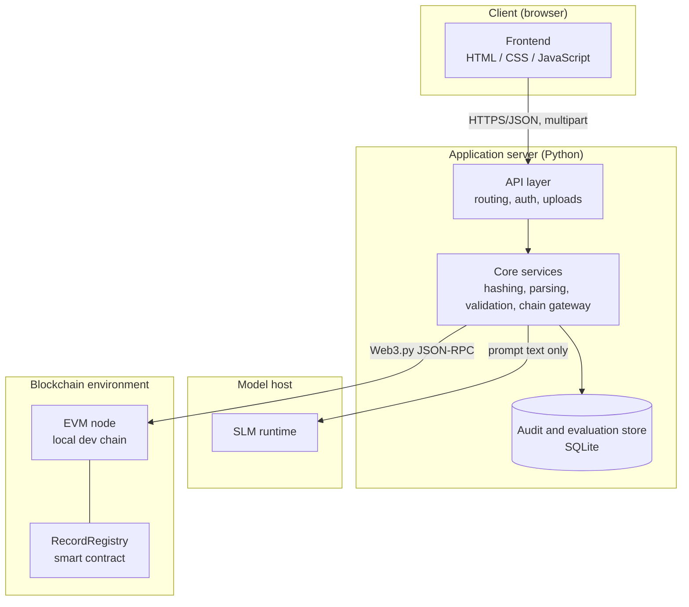

| Container | Responsibility | Technology (Proposed) |
|---|---|---|
| **Frontend** | Upload, query, admin, results views; animated explanation of validation | HTML, CSS, JavaScript (see `design.md`) |
| **API layer** | Request routing, schema checks on HTTP payloads, session auth, upload limits | FastAPI (or Flask) |
| **Core services** | Business logic shared by all routes (see §6) | Python modules |
| **Audit and evaluation store** | Request audit trail, evaluation runs and results | SQLite |
| **SLM runtime** | Turns text into a JSON *suggestion* | Open-source SLM, locally hosted |
| **EVM node + contract** | Immutable-ish registry of fingerprints and status | Hardhat local node, Solidity 0.8.x |

---

## 6. Backend component architecture (C4 level 3)

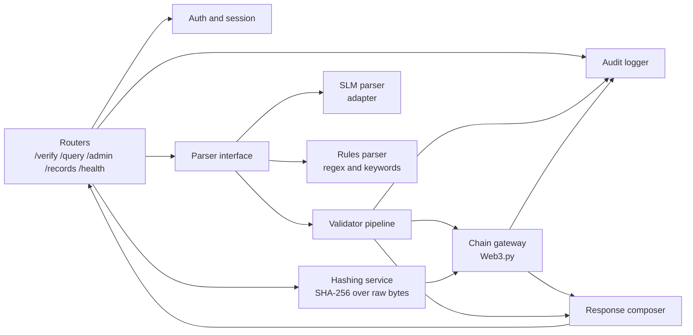

| Component | Responsibility | Key rules |
|---|---|---|
| **Routers** | HTTP surface; map errors to HTTP codes | No business logic |
| **Auth and session** | Admin login, role resolution | Role comes from the session, never from model output |
| **Hashing service** | Streams upload, computes SHA-256, discards bytes | Never stores files; limits size and type |
| **Parser interface** | `parse(text) -> RequestDraft` | Implemented by both SLM and rules parsers for a fair comparison |
| **SLM parser adapter** | Builds the prompt from text only; parses model output as JSON | Deterministic decoding; no document text; stateless |
| **Rules parser** | Regex and keyword baseline | Emits the same schema |
| **Validator pipeline** | Ordered, fail-closed checks (§8) | The only path to the chain gateway |
| **Chain gateway** | Calls predefined contract functions; handles receipts, timeouts, reverts | Exposes only: `register`, `verifyHash`, `getRecord`, `isRevoked`, `revoke` |
| **Response composer** | Builds a uniform response envelope | Always attaches the integrity disclaimer for results |
| **Audit logger** | Writes request ID, intent, outcome, failed stage, latency | No file content, no personal data |

---

## 7. Key runtime flows

### 7.1 Verify a file

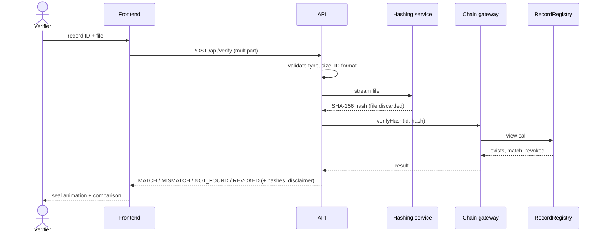

No language model is involved. This path is fully deterministic.

### 7.2 Natural-language query

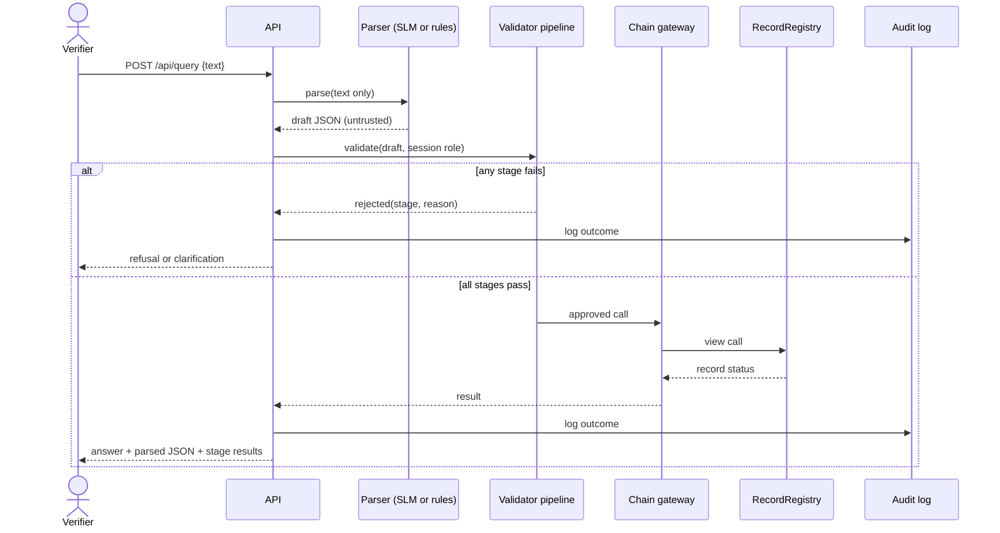

### 7.3 Admin register and revoke

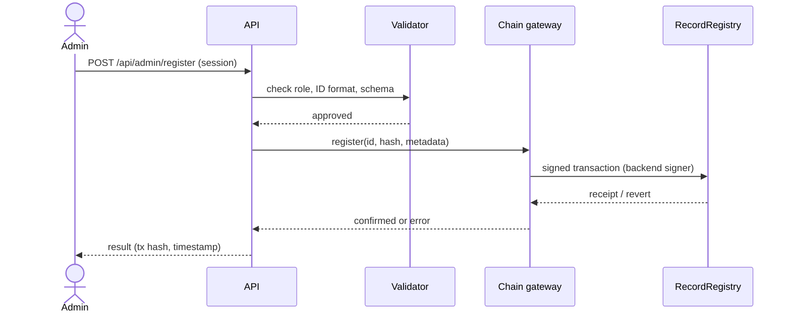

Revocation follows the same path with `revoke(id, reason)`.

### 7.4 Failure handling

| Failure | Detection | Behaviour |
|---|---|---|
| Blockchain unreachable | RPC timeout / connection error | `E_CHAIN_DOWN`; message states this is **not** a verification result |
| Model unavailable or timeout | Adapter timeout | `E_MODEL_DOWN`; user may use the rules parser or retry |
| Malformed model output | JSON parse / schema failure | Reject at stage 1; log; no chain call |
| Contract revert | Receipt status / revert reason | Map to `E_DUPLICATE`, `E_NOT_FOUND` or `E_UNAUTHORIZED` |
| Upload invalid | Type / size check | `E_UPLOAD_INVALID`; file never hashed |

---

## 8. Validation pipeline (security core)

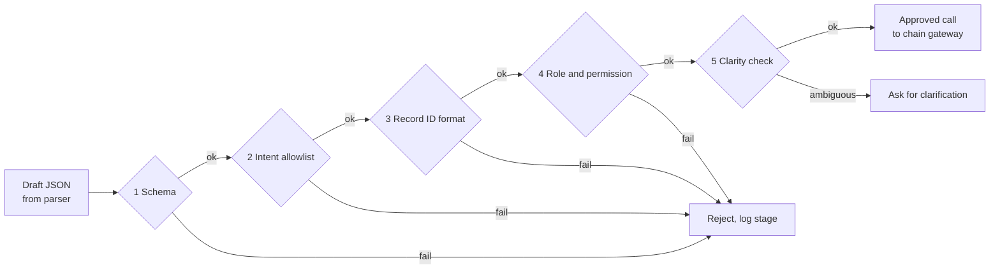

| Stage | Check | Failure code |
|---|---|---|
| 1 Schema | Valid JSON, only allowed fields and types | `E_SCHEMA` |
| 2 Intent allowlist | Intent ∈ {`verify_record`, `check_status`, `get_metadata`, `register_record`, `revoke_record`}; `unknown` refused | `E_INTENT` |
| 3 Record ID | Matches configured pattern (e.g., `^CERT-\d+$`) | `E_ID_FORMAT` |
| 4 Role | Privileged intents require an authenticated admin session | `E_UNAUTHORIZED` |
| 5 Clarity | Required fields present; `clarification_needed` false | `E_AMBIGUOUS` |

The pipeline is a **pure function** of (draft, session): no network or model calls inside it, which makes it exhaustively unit-testable. The signing account is chosen by the chain gateway from configuration and is never read from the draft.

---

## 9. Data architecture

### 9.1 On-chain (RecordRegistry)

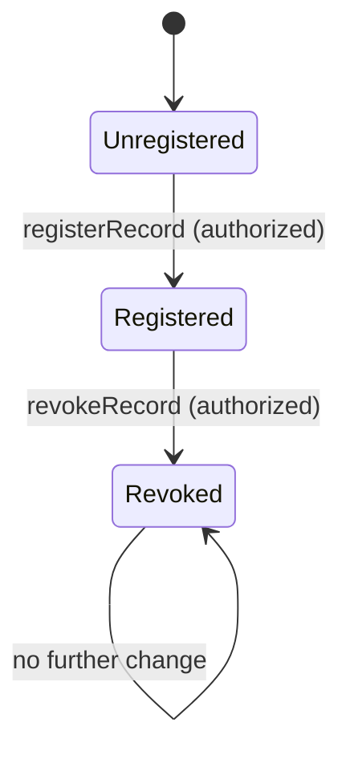

| Field | Type | Notes |
|---|---|---|
| key | `bytes32` = `keccak256(recordId)` | Cheap fixed-size key (**Proposed**); original ID emitted in events |
| `fileHash` | `bytes32` | SHA-256 digest of the certificate file |
| `issuer` | `address` | Account that registered it |
| `registeredAt` | `uint64` | Block timestamp |
| `revoked` | `bool` | Status flag |
| `revokedAt`, `reasonCode` | `uint64`, `uint8` | Set on revocation |

Never on-chain: documents, names, marks, contact data.

### 9.2 Off-chain (SQLite)

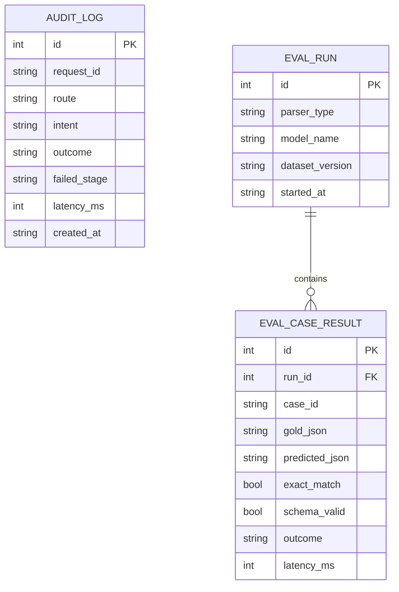

Privacy rules: audit rows contain no file content and no personal data. Raw query text is stored only for the synthetic evaluation dataset, not for ordinary requests (**Proposed**).

---

## 10. Smart-contract architecture

| Function | Access | Effect |
|---|---|---|
| `registerRecord(id, hash, metadata)` | Authorized | Creates a record; reverts on duplicate |
| `verifyHash(id, hash)` | Public view | Returns exists, match, revoked |
| `getRecord(id)` | Public view | Returns minimal metadata and status |
| `isRevoked(id)` | Public view | Returns status |
| `revokeRecord(id, reason)` | Authorized | Sets revoked; reverts if unknown |

- **Access control:** an owner/admin role manages the authorized accounts (e.g., OpenZeppelin AccessControl pattern, **Proposed**). The backend signer is granted the issuer role only.
- **Events:** `RecordRegistered(idHash, id, issuer)`, `RecordRevoked(idHash, reason)`.
- **Upgradeability:** none in the MVP (simpler, fewer attack paths). A new deployment replaces the old one.
- **Honest limitation:** if the backend signer key is compromised, an attacker can register or revoke records. Mitigations (separate owner key, restricted key storage) reduce but do not remove this; multi-signature approval is out of scope.

---

## 11. Interface architecture

Endpoints are defined in `prd.md` §11. All responses use one envelope:

```json
{
  "request_id": "string",
  "status": "ok | rejected | clarification | error",
  "result": { "state": "MATCH | MISMATCH | NOT_FOUND | REVOKED", "computed_hash": "…", "registered_hash": "…" },
  "handling": { "parsed": { }, "stages": [ { "name": "schema", "passed": true } ] },
  "error": { "code": "E_SCHEMA", "message": "human-readable" },
  "disclaimer": "A match shows the file is identical to what was registered..."
}
```

| HTTP | Used for |
|---|---|
| 200 | Successful answer, including NOT_FOUND / MISMATCH / REVOKED results |
| 400 | `E_SCHEMA`, `E_ID_FORMAT`, `E_UPLOAD_INVALID` |
| 401 / 403 | `E_UNAUTHORIZED` |
| 409 | `E_DUPLICATE` |
| 422 | `E_AMBIGUOUS` (clarification payload) |
| 503 | `E_CHAIN_DOWN`, `E_MODEL_DOWN` |

`handling.stages` is returned verbatim so the frontend's validation stepper shows **real** results (see `design.md`).

---

## 12. Security architecture

### 12.1 Trust zones

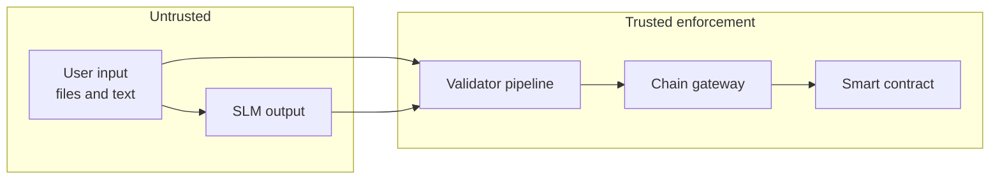

### 12.2 Defence in depth

| Layer | Control |
|---|---|
| Input | File type and size limits; ID pattern; text length cap |
| Model | Text-only prompt, no document content, stateless, deterministic decoding |
| Validator | Schema, allowlist, role, clarity (fail closed) |
| Gateway | Fixed function set; backend-chosen signer; timeouts; idempotent writes |
| Contract | `onlyAuthorized` on writes; duplicate and unknown-ID reverts |
| Operations | Secrets in environment variables; audit log; rate limiting (should) |

### 12.3 Threat to control mapping

| Threat | Primary control | Secondary control |
|---|---|---|
| Direct prompt injection | Validator allowlist and role | Contract access control |
| Indirect injection via documents | Document text never sent to SLM | Hash-only handling of files |
| Wrong or invented record ID | ID format + on-chain existence check | Clarification flow |
| Privilege escalation | Role from session, signer from config | Contract roles |
| Malformed JSON | Strict schema | Audit and alert in logs |
| Replay or duplicate writes | Contract duplicate revert | Idempotency key on admin API |

---

## 13. Deployment architecture

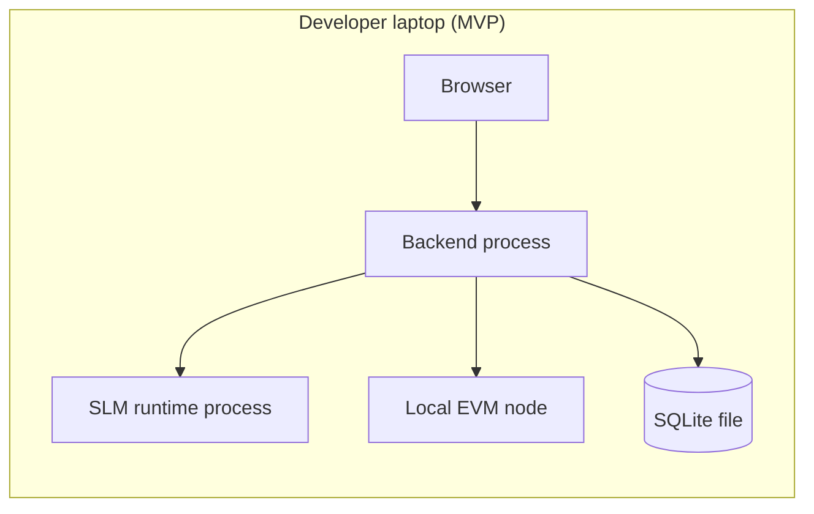

| Environment | Chain | Model | Purpose |
|---|---|---|---|
| **dev** | Local node, fresh state per run | Small local model | Daily development |
| **test** | Local node reset per suite | Mock parser and real SLM variants | Automated tests |
| **demo** | Local node seeded with synthetic records | Chosen SLM | Presentation |
| **stretch** | Public Ethereum testnet via RPC | Same | Optional showcase |

Hardware target: 8 GB RAM minimum, 16 GB recommended for the SLM. Docker Compose is optional (stretch) to make setup repeatable.

### Configuration (names only; no secrets in the repo)

| Variable | Purpose |
|---|---|
| `RPC_URL` | Blockchain node endpoint |
| `CONTRACT_ADDRESS` | Deployed registry address |
| `SIGNER_PRIVATE_KEY` | Backend signer (environment only, never committed) |
| `MODEL_NAME`, `MODEL_ENDPOINT` | SLM selection and runtime |
| `ID_PATTERN` | Allowed record-ID format |
| `MAX_UPLOAD_MB` | Upload limit |
| `ADMIN_CREDENTIALS_HASH` | Admin login verifier |
| `LOG_LEVEL`, `DB_PATH` | Operations |

---

## 14. Quality attribute tactics

| Attribute | Tactics |
|---|---|
| **Correctness** | Pure-function validator; schema-first design; exact-match tests on gold JSON |
| **Security** | Layered controls (§12); no model authority; least privilege |
| **Reliability** | Timeouts on RPC and model; receipt waiting; clear error classes; no silent retries on writes without idempotency |
| **Performance** | Stream uploads; keep model warm; read-only calls need no gas; record per-stage latency |
| **Testability** | Parser interface allows mock, rules and SLM; contract tests with fresh chain state |
| **Reproducibility** | Pinned dependency versions; temperature 0; seeded dataset split; versioned `dataset_version` |
| **Maintainability** | Module boundaries match §6; one responsibility per module |
| **Observability** | Request ID on every log line; per-stage outcomes in audit table |

---

## 15. Evaluation architecture

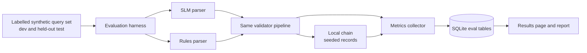

The harness runs both parsers through the **same** validation and chain path, records per-case outcomes, and exports results for the report. Security tests (unauthorized and injection cases) run through the full pipeline and report blocked/succeeded per attack type next to normal-task success.

---

## 16. Architecture decision records

| ID | Decision | Status | Rationale | Alternatives |
|---|---|---|---|---|
| ADR-1 | Backend framework: FastAPI | Proposed | Typed request/response models give strict validation and clear docs | Flask |
| ADR-2 | Contract toolchain: Hardhat, with Remix for quick experiments | Proposed | Scriptable tests and reproducible deployment | Remix only |
| ADR-3 | Record key = `keccak256(recordId)` | Proposed | Fixed-size key, cheaper storage | String-keyed mapping |
| ADR-4 | Locally hosted SLM | Proposed | No external API dependency; user queries stay local | Hosted model API |
| ADR-5 | Stateless NLP requests | Accepted by design | Removes memory-poisoning attack class | Conversation memory |
| ADR-6 | SQLite for audit and evaluation data | Proposed | Zero-setup, file-based | PostgreSQL |
| ADR-7 | Files hashed then discarded; never on-chain | Accepted by design | Privacy and gas cost | IPFS or file storage |
| ADR-8 | Hash raw uploaded bytes | Accepted by design | Simple, deterministic; limitation documented | Document normalisation |
| ADR-9 | Single deployable backend process | Proposed | Appropriate scale for a mini-project | Microservices |
| ADR-10 | Upgrade-free contract | Proposed | Smaller attack surface | Proxy pattern |

---

## 17. Repository structure (Proposed)

```
record-verifier/
├── contracts/            RecordRegistry.sol
├── test/                 contract tests
├── scripts/              deploy, seed records
├── backend/
│   ├── app/
│   │   ├── main.py
│   │   ├── routers/      verify.py  query.py  admin.py  records.py  health.py
│   │   ├── services/     hashing.py  chain_gateway.py  auth.py  audit.py
│   │   ├── nlp/          parser_interface.py  slm_parser.py  rules_parser.py
│   │   ├── validation/   pipeline.py  schema.py
│   │   └── config.py
│   └── tests/            unit, integration, security
├── eval/                 dataset/, harness.py, metrics.py, results/
├── frontend/             index.html  ask.html  admin.html  results.html  css/  js/
├── docs/                 prd.md  design.md  architecture.md
└── README.md
```

---

## 18. Constraints and limitations

- A matching hash proves **file integrity only**, not issuer legitimacy or truth of contents.
- Re-exported PDFs produce different hashes.
- The backend, RPC node and model host are centralized; the system is "blockchain-anchored with centralized components".
- Registry trust depends on the registration process and signer-key custody.
- Evaluation uses synthetic data and will not generalise automatically.

## 19. Future evolution

1. Issuer authentication through digital signatures and DID-based identity.
2. Standardised credential status (e.g., W3C status-list approach) and Verifiable Credentials alignment.
3. Privacy-preserving verification and selective disclosure.
4. Multi-issuer registry and multi-signature administration.
5. Evaluation of additional SLMs and constrained decoding variants.

## 20. Traceability to PRD

| PRD item | Architecture element |
|---|---|
| FR-01 to FR-06 (verify file) | §7.1, Hashing service, Chain gateway |
| FR-10 to FR-14 (registry) | §10, §7.3 |
| FR-20 to FR-27 (NLP) | §6 Parser interface, §8 Validator, §15 |
| FR-30 to FR-34 (UI, audit, health) | §5 Frontend, Audit logger, §11 envelope |
| SR-01 to SR-08 (security) | §12 |
| TC-01 to TC-10 (tests) | §14 testability, §15 harness |

## 21. Open decisions

1. Final SLM and runtime (decide in Week 3 after a quick hardware test).
2. FastAPI vs Flask (ADR-1) and Hardhat vs Remix (ADR-2).
3. Whether a public testnet deployment is required by the department.
4. Admin authentication mechanism (session cookie vs short-lived token).
5. Exact record-ID pattern and metadata fields.
