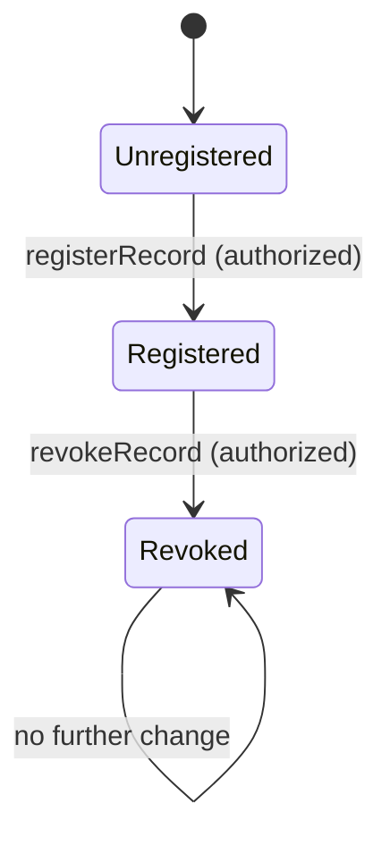
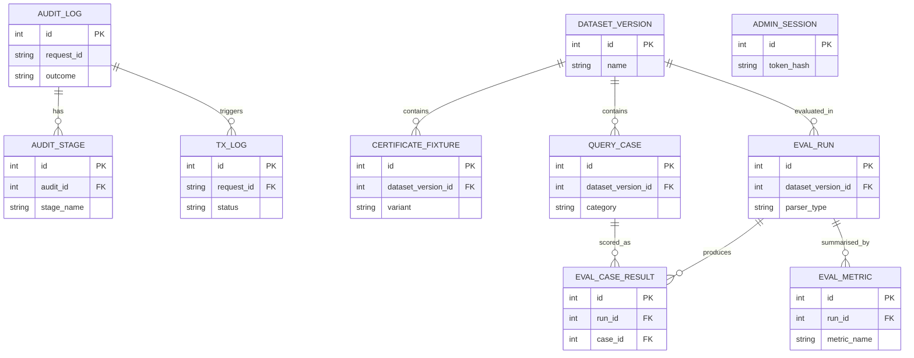
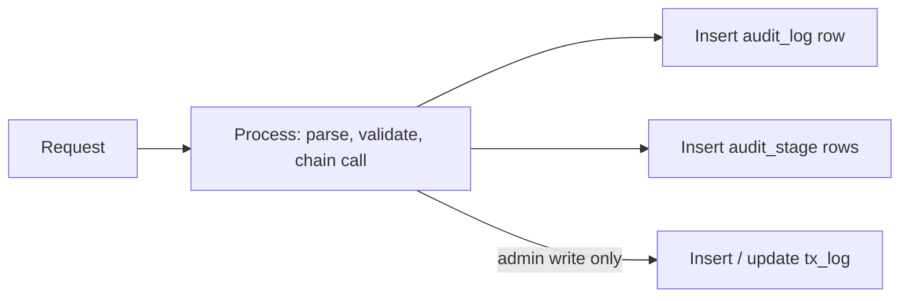
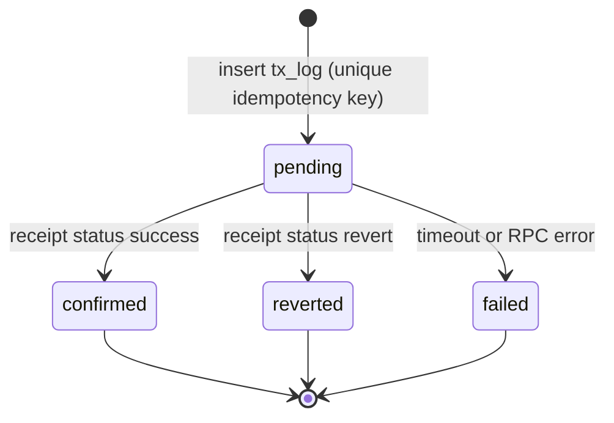
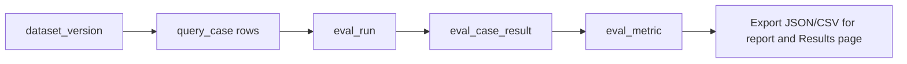

# DATABASE.md — Decentralized Record Verifier with NLP Search

| | |
|---|---|
| **Project** | Decentralized Record Verifier with NLP Search (Web3 & AI) |
| **Owner / Mentor** | Vipul Ahirrao / Dr. Dipak Bhadane |
| **Version** | 1.0 (proposal-stage design), 1 Nov 2026 |
| **Companions** | `prd.md`, `architecture.md`, `design.md` |
| **Status** | Design only. Schemas are **Proposed** and will be finalised in the design phase (Week 3). No data or results exist yet. |

---

## 1. Data strategy at a glance

The system has **two data stores with different jobs**. The split follows the architecture principle: minimal on-chain data, everything else off-chain, and no personal data in either.

| Store | Holds | Source of truth for | Technology |
|---|---|---|---|
| **On-chain registry** (smart contract storage and events) | Fingerprint, issuer, timestamps, revocation status | Whether a record exists, its registered hash, its status | Solidity 0.8.x on a local EVM chain |
| **Off-chain database** | Audit trail, admin write transactions, evaluation dataset and results | Operational history and experiment results | SQLite (file-based) |
| **Files** (outside both) | Synthetic certificate fixtures for tests | Test inputs only | Project folder |

**Golden rules**
1. The chain is authoritative for record state. The database **never overrides or caches** a verification answer.
2. Uploaded certificates are hashed and discarded; they are never stored in either store.
3. No personal data anywhere. All certificates, names and queries are synthetic.
4. Record IDs are **opaque** (for example `CERT-104`). They must never embed a name, roll number or other personal identifier, because IDs appear in public chain events and cannot be erased.

---

## 2. Data classification

| Data | Class | On-chain | Off-chain DB | Notes |
|---|---|---|---|---|
| Certificate file | Sensitive (in real use) | No | No | Hashed, then discarded |
| SHA-256 file hash | Public-safe fingerprint | Yes | Fixtures only | Cannot be reversed to the file |
| Record ID | Public identifier | Yes (events) | Hashed key in logs | Opaque by rule |
| Issuer address | Public | Yes | Optional | Backend signer account |
| Revocation status and reason code | Public | Yes | No | Reason is a code, not free text |
| Admin credentials | Secret | No | No | Only a hash in environment config |
| Admin session token | Secret | No | Hash only | Optional table |
| Request audit trail | Internal | No | Yes | No file content, no personal data |
| Natural-language query text | Internal | No | Only in the synthetic evaluation set | Ordinary requests are not stored verbatim |
| Evaluation dataset and results | Internal | No | Yes | Synthetic |

---

## 3. On-chain data model

### 3.1 Storage layout (Proposed)

```solidity
struct Record {
    bytes32 fileHash;     // SHA-256 digest of the certificate file
    address issuer;       // account that registered it (20 bytes)
    uint64  registeredAt; // block timestamp
    uint8   docType;      // 1=degree, 2=marksheet, 3=training certificate
    bool    exists;
    bool    revoked;
    uint8   reasonCode;   // 0 if not revoked
    uint64  revokedAt;    // 0 if not revoked
}

// key = keccak256(bytes(recordId))
mapping(bytes32 => Record) private records;
```

| Field | Type | Purpose |
|---|---|---|
| `fileHash` | `bytes32` | Compared with the hash computed from the uploaded file |
| `issuer` | `address` | Audit of who registered the record |
| `registeredAt` | `uint64` | When it was registered |
| `docType` | `uint8` | Non-personal category code (the "minimal metadata") |
| `exists` | `bool` | Distinguishes "unregistered" from a zero-valued record |
| `revoked`, `reasonCode`, `revokedAt` | `bool`, `uint8`, `uint64` | Revocation status |

Fields are ordered so the first group packs into two 32-byte storage slots (`fileHash`, then `issuer` + `registeredAt` + `docType` + three flags/codes). Confirm the packing with the compiler's storage-layout output before relying on it.

**Why `keccak256(recordId)` as the key:** a fixed-size key is cheaper and simpler than a string-keyed mapping (see ADR-3 in `architecture.md`). The original ID is emitted in an event so it can still be read from logs.

### 3.2 Events (the "index" of the chain)

| Event | Fields | Use |
|---|---|---|
| `RecordRegistered` | `bytes32 indexed key`, `string recordId`, `address indexed issuer`, `uint8 docType` | History, listing, demo timeline |
| `RecordRevoked` | `bytes32 indexed key`, `uint8 reasonCode` | Revocation history |

Events are the only way to enumerate records; the mapping itself cannot be iterated.

### 3.3 Record lifecycle



### 3.4 Revocation reason codes (Proposed)

| Code | Meaning |
|---|---|
| 1 | Issued in error |
| 2 | Superseded by a re-issued certificate |
| 3 | Fraud suspected |
| 4 | Other |

### 3.5 Integrity rules enforced by the contract

- Duplicate `registerRecord` for the same key reverts.
- `revokeRecord` on an unknown key reverts.
- Only authorized accounts may write.
- No delete function exists; revocation is permanent in the MVP.
- Chain data cannot be erased, which is why personal data is never stored.

---

## 4. Off-chain database design (SQLite)

### 4.1 Conventions

| Topic | Rule |
|---|---|
| Engine settings | `PRAGMA foreign_keys = ON;` and WAL journal mode |
| Timestamps | ISO-8601 UTC text, e.g. `2026-11-02T10:15:30.123Z` |
| Booleans | Integers `0` / `1` with `CHECK` constraints |
| JSON | Stored as text, validated with `json_valid()` |
| Naming | `snake_case`, singular table names, `id` primary keys |
| Access | Parameterized queries only; no string-built SQL |
| Migrations | Numbered files `migrations/001_init.sql`, tracked in `schema_migrations` |

### 4.2 Entity relationship overview



Two groups, no cross-links: **operational** tables (`audit_log`, `audit_stage`, `tx_log`, `admin_session`) and **evaluation** tables (`dataset_version` onward).

### 4.3 Schema (DDL, Proposed)

```sql
PRAGMA foreign_keys = ON;
PRAGMA journal_mode = WAL;

CREATE TABLE schema_migrations (
  version     INTEGER PRIMARY KEY,
  applied_at  TEXT NOT NULL DEFAULT (strftime('%Y-%m-%dT%H:%M:%fZ','now'))
);

-- ===== Operational tables =====

CREATE TABLE audit_log (
  id           INTEGER PRIMARY KEY AUTOINCREMENT,
  request_id   TEXT NOT NULL UNIQUE,
  route        TEXT NOT NULL,
  http_method  TEXT NOT NULL CHECK (http_method IN ('GET','POST')),
  parser_type  TEXT CHECK (parser_type IN ('slm','rules')),
  intent       TEXT,
  actor_role   TEXT NOT NULL DEFAULT 'anonymous' CHECK (actor_role IN ('anonymous','admin')),
  outcome      TEXT NOT NULL CHECK (outcome IN ('ok','rejected','clarification','error')),
  error_code   TEXT,
  failed_stage TEXT,
  http_status  INTEGER NOT NULL,
  latency_ms   INTEGER NOT NULL CHECK (latency_ms >= 0),
  created_at   TEXT NOT NULL DEFAULT (strftime('%Y-%m-%dT%H:%M:%fZ','now'))
);
CREATE INDEX idx_audit_created ON audit_log (created_at);
CREATE INDEX idx_audit_outcome ON audit_log (outcome, error_code);

CREATE TABLE audit_stage (
  id          INTEGER PRIMARY KEY AUTOINCREMENT,
  audit_id    INTEGER NOT NULL REFERENCES audit_log(id) ON DELETE CASCADE,
  stage_order INTEGER NOT NULL CHECK (stage_order BETWEEN 1 AND 5),
  stage_name  TEXT NOT NULL CHECK (stage_name IN
                ('schema','intent_allowlist','record_id','role','clarity')),
  passed      INTEGER NOT NULL CHECK (passed IN (0,1)),
  reason      TEXT,
  UNIQUE (audit_id, stage_order)
);

CREATE TABLE tx_log (
  id               INTEGER PRIMARY KEY AUTOINCREMENT,
  request_id       TEXT NOT NULL REFERENCES audit_log(request_id),
  idempotency_key  TEXT NOT NULL UNIQUE,
  operation        TEXT NOT NULL CHECK (operation IN ('register','revoke')),
  record_key       TEXT NOT NULL,              -- keccak256(recordId), hex
  tx_hash          TEXT,
  status           TEXT NOT NULL CHECK (status IN ('pending','confirmed','reverted','failed')),
  error_code       TEXT,
  block_number     INTEGER,
  submitted_at     TEXT NOT NULL,
  confirmed_at     TEXT,
  confirmation_ms  INTEGER CHECK (confirmation_ms IS NULL OR confirmation_ms >= 0)
);
CREATE INDEX idx_tx_status ON tx_log (status);

-- Only needed if session-based admin login is chosen (open decision)
CREATE TABLE admin_session (
  id          INTEGER PRIMARY KEY AUTOINCREMENT,
  token_hash  TEXT NOT NULL UNIQUE,
  created_at  TEXT NOT NULL,
  expires_at  TEXT NOT NULL,
  revoked     INTEGER NOT NULL DEFAULT 0 CHECK (revoked IN (0,1))
);

-- ===== Evaluation tables =====

CREATE TABLE dataset_version (
  id          INTEGER PRIMARY KEY AUTOINCREMENT,
  name        TEXT NOT NULL UNIQUE,            -- e.g. 'v1'
  description TEXT,
  split_seed  INTEGER,                         -- seed used for dev/test split
  created_at  TEXT NOT NULL
);

CREATE TABLE certificate_fixture (
  id                 INTEGER PRIMARY KEY AUTOINCREMENT,
  dataset_version_id INTEGER NOT NULL REFERENCES dataset_version(id),
  record_id          TEXT NOT NULL,
  variant            TEXT NOT NULL CHECK (variant IN
                       ('original','modified','revoked','unregistered')),
  file_name          TEXT NOT NULL,
  sha256             TEXT NOT NULL CHECK (length(sha256) = 64),
  expected_state     TEXT NOT NULL CHECK (expected_state IN
                       ('MATCH','MISMATCH','NOT_FOUND','REVOKED')),
  UNIQUE (dataset_version_id, record_id, variant)
);

CREATE TABLE query_case (
  id                 INTEGER PRIMARY KEY AUTOINCREMENT,
  dataset_version_id INTEGER NOT NULL REFERENCES dataset_version(id),
  case_code          TEXT NOT NULL,            -- e.g. 'Q-0042'
  split              TEXT NOT NULL CHECK (split IN ('dev','test')),
  category           TEXT NOT NULL CHECK (category IN
                       ('valid','unknown_id','revoked','ambiguous',
                        'malformed_output','unauthorized','injection','out_of_scope')),
  tier               TEXT NOT NULL CHECK (tier IN ('templated','paraphrased','informal')),
  query_text         TEXT NOT NULL,
  gold_json          TEXT NOT NULL CHECK (json_valid(gold_json)),
  expected_outcome   TEXT NOT NULL CHECK (expected_outcome IN
                       ('ok','rejected','clarification')),
  actor_role         TEXT NOT NULL DEFAULT 'anonymous' CHECK (actor_role IN ('anonymous','admin')),
  attack_type        TEXT,                     -- for 'injection' cases
  forced_output      TEXT,                     -- fixed model output for 'malformed_output' tests
  UNIQUE (dataset_version_id, case_code)
);
CREATE INDEX idx_case_split ON query_case (dataset_version_id, split, category);

CREATE TABLE eval_run (
  id                 INTEGER PRIMARY KEY AUTOINCREMENT,
  dataset_version_id INTEGER NOT NULL REFERENCES dataset_version(id),
  parser_type        TEXT NOT NULL CHECK (parser_type IN ('slm','rules')),
  model_name         TEXT,                     -- NULL for rules parser
  model_params       TEXT CHECK (model_params IS NULL OR json_valid(model_params)),
  constrained_decoding INTEGER NOT NULL DEFAULT 0 CHECK (constrained_decoding IN (0,1)),
  split              TEXT NOT NULL CHECK (split IN ('dev','test')),
  seed               INTEGER,
  started_at         TEXT NOT NULL,
  finished_at        TEXT,
  notes              TEXT
);

CREATE TABLE eval_case_result (
  id              INTEGER PRIMARY KEY AUTOINCREMENT,
  run_id          INTEGER NOT NULL REFERENCES eval_run(id) ON DELETE CASCADE,
  case_id         INTEGER NOT NULL REFERENCES query_case(id),
  raw_output      TEXT,
  predicted_json  TEXT CHECK (predicted_json IS NULL OR json_valid(predicted_json)),
  schema_valid    INTEGER NOT NULL CHECK (schema_valid IN (0,1)),
  intent_correct  INTEGER CHECK (intent_correct IN (0,1)),
  id_correct      INTEGER CHECK (id_correct IN (0,1)),
  exact_match     INTEGER CHECK (exact_match IN (0,1)),
  final_outcome   TEXT NOT NULL CHECK (final_outcome IN ('ok','rejected','clarification','error')),
  blocked_stage   TEXT,
  security_pass   INTEGER CHECK (security_pass IN (0,1)),  -- attack blocked / unauthorized refused
  latency_ms      INTEGER CHECK (latency_ms >= 0),
  UNIQUE (run_id, case_id)
);
CREATE INDEX idx_result_run ON eval_case_result (run_id);

CREATE TABLE eval_metric (
  id           INTEGER PRIMARY KEY AUTOINCREMENT,
  run_id       INTEGER NOT NULL REFERENCES eval_run(id) ON DELETE CASCADE,
  metric_name  TEXT NOT NULL,                  -- e.g. 'intent_accuracy'
  group_key    TEXT NOT NULL DEFAULT 'all',    -- e.g. tier or category
  value        REAL NOT NULL,
  ci_low       REAL,
  ci_high      REAL,
  n            INTEGER NOT NULL,
  UNIQUE (run_id, metric_name, group_key)
);
```

---

## 5. Data dictionary (selected tables)

### `audit_log`
| Column | Description |
|---|---|
| `request_id` | Unique ID attached to every log line and API response |
| `route` | e.g. `/api/query` |
| `parser_type` | Which interpreter handled a query (`slm` or `rules`) |
| `intent` | Validated intent, if one was parsed |
| `actor_role` | Role from the session; **never** from model output |
| `outcome` | `ok`, `rejected`, `clarification` or `error` |
| `error_code` | `E_SCHEMA`, `E_INTENT`, `E_ID_FORMAT`, `E_UNAUTHORIZED`, `E_AMBIGUOUS`, `E_CHAIN_DOWN`, `E_MODEL_DOWN`, `E_UPLOAD_INVALID`, `E_DUPLICATE`, `E_NOT_FOUND` |
| `failed_stage` | First validation stage that failed |
| `latency_ms` | End-to-end time for the request |

### `tx_log`
| Column | Description |
|---|---|
| `idempotency_key` | Client-supplied key; prevents duplicate writes on retry |
| `record_key` | `keccak256(recordId)` as hex, so IDs are not duplicated in plain text |
| `status` | `pending` → `confirmed` / `reverted` / `failed` |
| `confirmation_ms` | Time from submission to confirmation (feeds the performance metrics) |

### `query_case`
| Column | Description |
|---|---|
| `category` | Test group matching the PRD test cases (valid, unknown ID, revoked, ambiguous, malformed output, unauthorized, injection, out of scope) |
| `tier` | Difficulty tier for fair comparison: templated, paraphrased, informal |
| `gold_json` | The correct structured request (ground truth) |
| `expected_outcome` | What the full pipeline should do (`ok`, `rejected`, `clarification`) |
| `forced_output` | Fixed output injected in place of the model, used to test malformed JSON handling (TC-06) |

### `eval_case_result`
| Column | Description |
|---|---|
| `schema_valid` | Output parsed and matched the schema |
| `exact_match` | Predicted JSON equals `gold_json` |
| `security_pass` | For attack and unauthorized cases: the request was blocked |
| `blocked_stage` | Which validation stage stopped it, if any |

---

## 6. Key data flows

### 6.1 Request audit



A request writes its audit row even when it fails; failures are the most useful rows.

### 6.2 Admin write with idempotency



On a retry with the same key, the backend returns the existing row instead of sending a second transaction. On startup, any `pending` rows older than a timeout are reconciled against the chain by transaction hash.

### 6.3 Evaluation run



---

## 7. Useful queries (examples)

**Intent accuracy by difficulty tier (held-out test split):**
```sql
SELECT r.id AS run_id, r.parser_type, q.tier,
       COUNT(*)                  AS n,
       AVG(res.intent_correct)   AS intent_accuracy
FROM eval_case_result res
JOIN eval_run   r ON r.id = res.run_id
JOIN query_case q ON q.id = res.case_id
WHERE r.split = 'test' AND q.category = 'valid'
GROUP BY r.id, r.parser_type, q.tier;
```

**Block rate for unauthorized and injection cases:**
```sql
SELECT r.id AS run_id, q.category,
       COUNT(*)              AS attempted,
       SUM(res.security_pass) AS blocked,
       1.0 * SUM(res.security_pass) / COUNT(*) AS block_rate
FROM eval_case_result res
JOIN eval_run   r ON r.id = res.run_id
JOIN query_case q ON q.id = res.case_id
WHERE q.category IN ('unauthorized','injection','out_of_scope')
GROUP BY r.id, q.category;
```

**Which validation stage stops requests most often:**
```sql
SELECT stage_name, COUNT(*) AS failures
FROM audit_stage
WHERE passed = 0
GROUP BY stage_name
ORDER BY failures DESC;
```

**95th-percentile latency for a run (nearest-rank method):**
```sql
WITH ranked AS (
  SELECT latency_ms,
         ROW_NUMBER() OVER (ORDER BY latency_ms) AS rn,
         COUNT(*) OVER ()                         AS cnt
  FROM eval_case_result
  WHERE run_id = :run_id
)
SELECT latency_ms AS p95_ms
FROM ranked
WHERE rn = CAST(0.95 * cnt + 0.999999 AS INTEGER);
```

**Stuck admin transactions:**
```sql
SELECT id, operation, tx_hash, submitted_at
FROM tx_log
WHERE status = 'pending'
  AND submitted_at < strftime('%Y-%m-%dT%H:%M:%fZ','now','-5 minutes');
```

---

## 8. Seed and fixture data (synthetic)

| Fixture | Purpose | Expected state |
|---|---|---|
| `CERT-101` original file, registered | TC-01 | `MATCH` |
| `CERT-101` modified file (one byte or text change) | TC-02 | `MISMATCH` |
| `CERT-999` never registered | TC-03 | `NOT_FOUND` |
| `CERT-103` registered then revoked | TC-04 | `REVOKED` |
| `CERT-104` registered, file re-saved by another PDF viewer | Documented limitation: byte-level hash mismatch | `MISMATCH` |

Query cases cover each category with templated, paraphrased and informal tiers. A suggested starting size is a few dozen cases per category, adjusted to what is feasible; the dev/test split is made once with a recorded `split_seed` and never changed afterwards.

All fixture content is invented: no real names, marks or institutions.

---

## 9. Integrity, security and privacy

| Concern | Control |
|---|---|
| SQL injection | Parameterized queries only; no dynamic SQL from user text |
| Referential integrity | Foreign keys on, `CHECK` constraints on enumerations |
| Duplicate writes | `UNIQUE` idempotency key; contract duplicate revert as second line of defence |
| Tampering with evaluation | Dataset versions are append-only; test split frozen; runs record model name and parameters |
| Secrets | No keys or passwords in the database; admin credentials only as a hash in environment config |
| Personal data | None stored; ordinary query text is not persisted |
| Log hygiene | Logs record IDs as `keccak256` keys where possible; never file contents |
| Chain/database divergence | Chain wins; `tx_log` is reconciled against receipts, never used to answer verification questions |

---

## 10. Retention, backup and migration

| Topic | Approach |
|---|---|
| **Audit log** | Keep during development and demo; purge rows older than a set period (for example 30 days) with a scheduled script |
| **Evaluation data** | Keep all runs; export each run to `eval/results/run_<id>.json` for the report |
| **Backup** | Copy the SQLite file (WAL checkpoint first) before each major experiment; keep dataset SQL and fixtures in Git |
| **Chain state** | Reproducible: redeploy the contract and run the seed script; do not back up the local chain |
| **Migrations** | Forward-only numbered SQL files; applied versions recorded in `schema_migrations` |
| **Reset** | One script drops and rebuilds the database and reseeds fixtures for repeatable test runs |

---

## 11. Capacity and performance notes

- Expected volume is tiny (a laptop prototype, hundreds to thousands of rows), so SQLite with the indexes above is sufficient.
- Verification reads go to the chain, not the database; read-only contract calls need no gas.
- The write path to the database is one audit row plus up to five stage rows per request; keep it in a single short transaction.
- If the project were scaled beyond a prototype, the first changes would be moving to a server database and indexing chain events in a dedicated indexer. These are out of scope here.

---

## 12. Traceability

| Requirement | Data element |
|---|---|
| FR-02, FR-03 (hash and compare) | Contract `fileHash`; fixtures `sha256` |
| FR-10 to FR-14 (registry) | Contract struct, events, access control |
| FR-22 (validation stages) | `audit_stage` |
| FR-33 (audit log without personal data) | `audit_log` |
| FR-27 and PRD §14 (baseline comparison) | `eval_run.parser_type`, `eval_case_result` |
| SR-01, SR-04 (access control, no personal data) | §3.5, §9 |
| TC-01 to TC-10 | `certificate_fixture`, `query_case.category` |
| Metrics (accuracy, rejection, latency, confirmation time) | `eval_metric`, `tx_log.confirmation_ms`, §7 queries |

---

## 13. Open decisions

1. Final contents of "minimal metadata" (the `docType` code is proposed; anything more must remain non-personal).
2. Whether admin login uses sessions (needs `admin_session`) or short-lived tokens (no table).
3. Whether ordinary query text should be stored in a development-only debug mode.
4. Size of the synthetic query set per category.
5. Whether to add a simple chain-event indexer table for the demo record list (otherwise read events directly).
