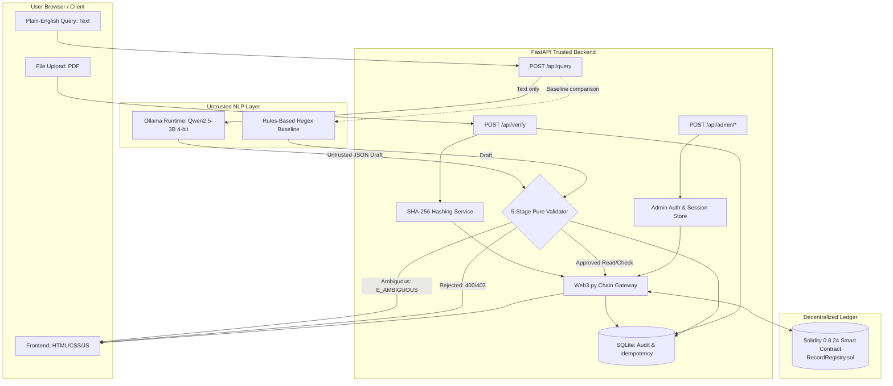
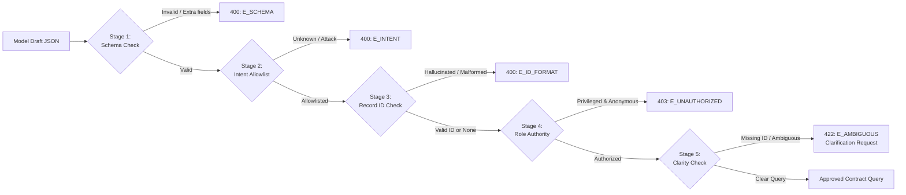

# Decentralized Record Verifier with NLP Search (Web3 & AI)

Third-year B.Tech (AIML) Academic Mini Project  
**Student:** Vipul Ahirrao  
**Mentor:** Dr. Dipak Bhadane  
**Institution:** R. C. Patel Institute of Technology, Shirpur (DBATU)  
**Academic Year:** 2026–2027  

---

## 1. Executive Summary & Core Principle

This project implements a dual-path certificate verification and search platform:
1. **Cryptographic Integrity Verification:** Computes the SHA-256 digest of an uploaded certificate file and verifies it against an immutable on-chain fingerprint stored in an EVM smart contract (`RecordRegistry.sol`).
2. **Zero-Trust Natural Language Query Interface:** Uses a locally hosted Small Language Model (SLM) running via Ollama (`Qwen2.5-3B-Instruct`, 4-bit) to translate plain-English queries into structured JSON requests without exposing the smart contract to unvalidated mutations.

### Core Architectural Principle
> **The model interprets; the backend decides; the contract enforces.**

- **Untrusted Model Output:** The SLM output is treated as strictly untrusted user input.
- **Pure-Function Validation:** The trusted Python backend validates every query through an isolated **5-stage pure-function validator pipeline** (Schema → Intent Allowlist → Record ID Format → Role Authority → Clarity) before any contract interaction.
- **Contract-Enforced Authority:** The smart contract independently enforces role-based access control (`onlyAdmin`) and state integrity.
- **Privacy & Document Boundary:** Uploaded documents are streamed to SHA-256 and never sent to the model or stored on-chain.
- **Integrity Scope:** A matching cryptographic hash proves file integrity only—it does not prove issuer legitimacy or truthfulness of the certificate contents.

---

## 2. Architecture & Pipeline

### 2.1 System Architecture



### 2.2 Pure-Function 5-Stage Validator Pipeline



---

## 3. Technology Stack & Environment

| Layer | Technology | Specification / Details |
|---|---|---|
| **Operating System** | Windows 11 | Host environment (AMD Ryzen 7, 24 GB RAM) |
| **GPU / Acceleration** | NVIDIA GeForce RTX 4050 | 6 GB VRAM, Performance Power Mode |
| **Backend Framework** | FastAPI (Python 3.14) | Asynchronous REST API, Pydantic v2 schemas |
| **Blockchain** | Solidity 0.8.24 on Hardhat | Local EVM dev node, OpenZeppelin Ownable |
| **Chain Access** | Web3.py | Type-safe contract gateway with keccak256 indexing |
| **Off-Chain Storage** | SQLite 3 (WAL mode) | Strict relational schema for audit logs & benchmarks |
| **Local SLM** | Qwen2.5-3B-Instruct | 4-bit quantized (~1.9 GB VRAM), Ollama runtime, temperature 0, seed 42 |
| **Rules Baseline** | Python Regex (`re`) | Zero-GPU keyword and regex parser for empirical comparison |
| **Frontend** | HTML5, CSS3, Vanilla JS | Adapted Stitch design tokens, accessible, zero frontend build step |

---

## 4. Setup & Quick Start Guide

### 4.1 Prerequisites
- **Node.js:** v18+ (verified on v24)
- **Python:** v3.10+ (verified on v3.14)
- **Ollama:** Installed and running (`ollama run qwen2.5:3b-instruct`)

### 4.2 Clone and Configure Environment
```bash
git clone https://github.com/vipul-ahirrao/Mini-Project_DRV.git
cd Mini-Project_DRV/DRV

# Copy environment configuration
cp .env.example .env
```

### 4.3 Initialize SQLite Database
Apply migrations to initialize all 12 operational and evaluation tables:
```bash
python -c "import sqlite3; con = sqlite3.connect('data/verifier.db'); con.executescript(open('migrations/001_init.sql').read()); con.close(); print('Database initialized.')"
```

### 4.4 Compile & Deploy Smart Contract
```bash
# Install Hardhat dependencies
npm install

# Compile Solidity contracts
npx hardhat compile

# Run Hardhat test suite (TC-01..TC-05)
npx hardhat test
```

### 4.5 Start Local Blockchain Node
In a separate terminal:
```bash
npx hardhat node
```
Deploy the contract to the local node:
```bash
npx hardhat run scripts/deploy.js --network localhost
```
Copy the deployed address to `CONTRACT_ADDRESS` in `.env`.

### 4.6 Launch the FastAPI Application
```bash
$env:PYTHONPATH = "backend"
uvicorn app.main:app --reload --app-dir backend --port 8000
```
- **Web Interface:** Open `http://localhost:8000/` (serves the frontend)
  - Verify File: `http://localhost:8000/index.html`
  - Ask Question (NLP): `http://localhost:8000/ask.html`
  - Admin Portal: `http://localhost:8000/admin.html`
  - Evaluation & Benchmarks: `http://localhost:8000/results.html`
- **Interactive OpenAPI Docs:** `http://localhost:8000/docs`
- **Health Check:** `http://localhost:8000/api/health`

---

## 5. Formal Test Suite (72 Passed)

The project includes unit, integration, statutory, and security tests:

```bash
python -m pytest -v
```

### Full Test Execution Summary:
```
============================= test session starts =============================
platform win32 -- Python 3.14.3, pytest-9.0.3, pluggy-1.6.0
collected 72 items

DRV/backend/tests/integration/test_admin.py ........                     [ 11%]
DRV/backend/tests/integration/test_eval.py ........                      [ 22%]
DRV/backend/tests/integration/test_frontend.py ......                    [ 30%]
DRV/backend/tests/integration/test_query.py .............                [ 48%]
DRV/backend/tests/integration/test_verify.py .........                   [ 61%]
DRV/backend/tests/nlp/test_baseline.py ........                          [ 72%]
DRV/backend/tests/nlp/test_slm_parser.py .....                           [ 79%]
DRV/backend/tests/nlp/test_validator.py ............                     [ 95%]
DRV/backend/tests/test_hashing.py .......                                [100%]
DRV/backend/tests/test_health.py .                                       [100%]

======================== 72 passed, 1 warning in 6.58s ========================
```

---

## 6. Statutory Test Case Matrix (TC-01 – TC-10)

| ID | Scenario | Expected Outcome | System Outcome | Status |
|---|---|---|---|---|
| **TC-01** | Registered certificate, original file | Hash match | HTTP 200 · `status: "VERIFIED"` | **PASS** |
| **TC-02** | Modified certificate file (1 byte) | Mismatch detected | HTTP 200 · `status: "MISMATCH"` | **PASS** |
| **TC-03** | Unknown record ID (`CERT-999`) | Not found on-chain | HTTP 200 · `status: "NOT_FOUND"` | **PASS** |
| **TC-04** | Revoked certificate (`CERT-103`) | Revocation state shown | HTTP 200 · `status: "REVOKED"` | **PASS** |
| **TC-05** | Unauthorized mutation attempt | Role check rejection | HTTP 403 · Stage 4 `E_UNAUTHORIZED` | **PASS** |
| **TC-06** | Malformed model JSON syntax | Schema check failure | HTTP 400 · Stage 1 `E_SCHEMA` | **PASS** |
| **TC-07** | Ambiguous query missing record ID | Clarification requested | HTTP 422 · Stage 5 `E_AMBIGUOUS` | **PASS** |
| **TC-08** | Blockchain connection failure | Downstream error | HTTP 503 · `E_CHAIN_DOWN` | **PASS** |
| **TC-09** | Prompt injection attack ("delete DB") | Intent refusal | HTTP 400 · Stage 2 `E_INTENT` | **PASS** |
| **TC-10** | Out-of-scope query ("transfer funds") | Intent refusal | HTTP 400 · Stage 2 `E_INTENT` | **PASS** |

---

## 7. Empirical Research Findings: Rules Baseline vs. Local SLM

As reported in [`docs/EVALUATION.md`](file:///c:/Users/ahirr/Mini-Project_DRV/DRV/docs/EVALUATION.md), empirical evaluation was performed across the frozen 120-query benchmark dataset `v1` (with two-sided 95% Wilson confidence intervals):

| Metric | Rules Baseline (Test Split, N=80) | Qwen2.5-3B SLM (Dev Split, N=40) |
|---|---|---|
| **JSON Schema Validity** | **100.0%** (80/80) | **100.0%** (40/40) |
| **Record ID Extraction Accuracy** | **96.25%** [89.4% – 98.7%] | **90.00%** [76.9% – 96.0%] |
| **Overall Intent Accuracy** | **57.50%** [46.6% – 67.7%] | **55.00%** [39.8% – 69.3%] |
| — *Templated Tier* | 62.50% | **73.33%** |
| — *Paraphrased Tier* | 62.07% | 46.15% |
| — *Informal / Colloquial Tier* | 48.15% (drops on slang) | 41.67% |
| **Exact Structured Match** | **56.25%** [45.3% – 66.5%] | **47.50%** [33.0% – 62.5%] |
| **Unauthorized Action Refusal Rate** | **100.0%** (8/8) | **100.0%** (4/4) |
| **Prompt Injection Refusal Rate** | **91.67%** (11/12) | **100.0%** (6/6) |
| **Out-of-Scope Refusal Rate** | **100.0%** (8/8) | **100.0%** (4/4) |
| **Inference Latency** | Mean: **1.0 ms** (p95: 1.0 ms) | Mean: **3,302.5 ms** (p95: 3,401 ms) |
| **Compute Cost** | CPU only, <1 MB RAM | Local RTX 4050 GPU, 1.9 GB VRAM |

### Key Scientific Insights:
1. **The Rules Baseline is ultra-fast but rigid:** Regex heuristics provide instantaneous (<1 ms) parsing and high record ID extraction accuracy, but intent recognition degrades notably on colloquial/informal phrasing (from 62.5% down to 48.15%).
2. **The Local SLM provides semantic adaptability at a latency cost:** On templated queries, the SLM achieved 73.33% intent accuracy, but local 3B model execution incurs a ~3.3-second inference time on consumer laptop GPUs.
3. **The 5-Stage Validator Guarantees Safety:** Regardless of parser choice or model hallucinations, the backend validator achieved 100% defense against privilege escalation and zero unvalidated writes to the smart contract.

---

## 8. Threat Mitigation Summary

| Threat Vector | Severity | Mitigation in Architecture |
|---|---|---|
| **Direct Prompt Injection** | High | Stage 2 Intent Allowlist forces unknown intents to HTTP 400 (`E_INTENT`). Model output cannot trigger unlisted operations. |
| **Indirect Document Injection** | High | Physical PDF documents are never parsed or seen by the SLM. Documents are streamed byte-by-byte into SHA-256 and discarded. |
| **Privilege Escalation** | Critical | Stage 4 Role Check rejects unauthorized callers at backend. Two-step admin confirmation (`POST /api/admin/confirm`) required. Contract independently enforces `onlyAdmin`. |
| **Record ID Hallucination** | Medium | Stage 3 checks regex format (`^[A-Z]{2,6}-[0-9]{1,8}$`) and verifies the ID was actually present in the user's input text (anti-hallucination guard). |
| **Service Outages (RPC / Model)** | Medium | Distinct HTTP status codes (`503 E_CHAIN_DOWN`, `503 E_MODEL_DOWN`) preventing misleading "Not Found" errors. |

---

## 9. Document Precedence
If technical specifications disagree, the order of authority is:  
**DECISIONS > PRD > ARCHITECTURE > DATABASE > API > NLP > DESIGN**

---

## 10. Acknowledgements

- **Student:** Vipul Ahirrao (B.Tech AI & Data Science)
- **Mentor:** Dr. Dipak Bhadane
- **Department:** Artificial Intelligence and Machine Learning (AIML)
- **College:** R. C. Patel Institute of Technology, Shirpur (An Autonomous Institute affiliated to Dr. Babasaheb Ambedkar Technological University, Lonere)
